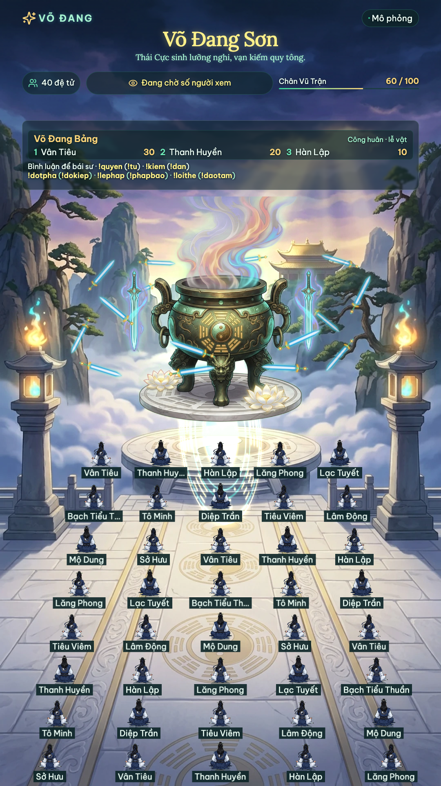
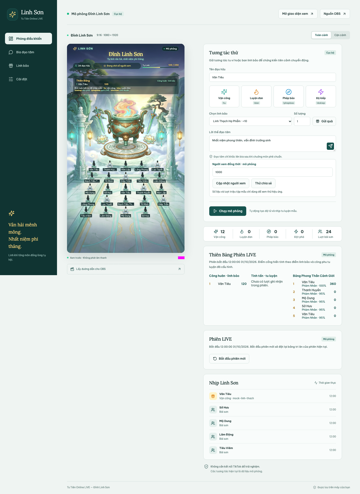
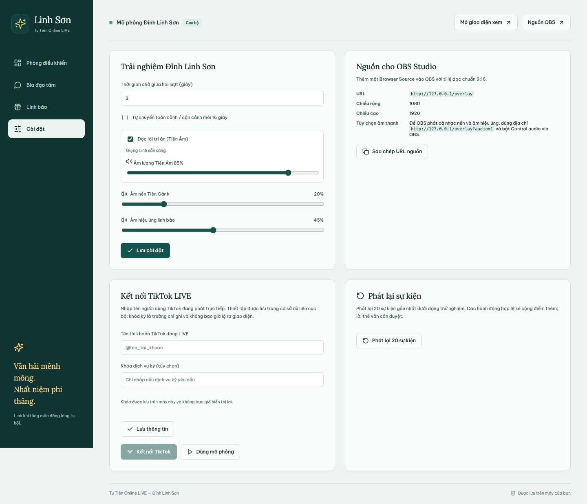

[](https://github.com/mashupsolution/an-nhien-pagoda/actions/workflows/build.yml) <br>
# Tu Tiên Online LIVE — Đỉnh Linh Sơn Vân Hải

> *Tụ linh vân hải, nhất niệm phi thăng.*

Trò chơi tương tác tu tiên thời gian thực chạy ngay trên máy của bạn, thiết kế chuẩn tỉ lệ dọc 9:16 (1080×1920) dành cho buổi LIVE TikTok / OBS: 40 đệ tử tọa thiền vận công, Tứ Linh Đỉnh rực cháy ngũ sắc chân hỏa, phi kiếm hộ pháp lượn quanh, lôi kiếp thử thách đột phá cảnh giới, Bảng Phong Thần Cảnh Giới và Tụ Linh Đại Trận của cả tông môn. Mặc định chạy ở chế độ **mô phỏng**, không cần tài khoản TikTok để thử.

**Công nghệ:** Phaser 4.2.1 · React 19 · TypeScript · Node.js 24 · SQLite

## Giao diện

<table>
  <tr>
    <td align="center" valign="top" width="34%">
      <br>
      <sub><b>Đỉnh Linh Sơn</b> (<code>/game</code>, <code>/overlay</code>)<br>Cảnh dọc 9:16 dùng cho OBS. Đệ tử xếp trận tọa thiền, Thiên Bảng và Tụ Linh Đại Trận.</sub>
    </td>
    <td align="center" valign="top" width="66%">
      <br>
      <sub><b>Phòng điều khiển</b> (<code>/admin</code>)<br>Xem trước cảnh, gửi tương tác thử (!tu, !dan, !phapbao, !dokiep), cập nhật số người xem, theo dõi Thiên Bảng & Bảng Phong Thần Cảnh Giới.</sub>
    </td>
  </tr>
</table>

<p align="center">
  <br>
  <sub><b>Cài đặt</b>: Tiên Âm Linh, âm nền tiên cảnh, âm thanh linh bảo, đường dẫn nguồn OBS và kết nối TikTok.</sub>
</p>

## Tính năng chính

- Cảnh tiên môn vẽ nhiều lớp kiểu 2.5D trong bảng màu Vân Ngọc & Kim Quang: Tứ Linh Đỉnh đồng ngọc, linh đài Bát Quái, trụ đá tiên môn, phi kiếm hộ pháp, tối đa **40 đệ tử** tọa thiền cùng lúc; hai góc nhìn toàn cảnh và cận cảnh (Tứ Linh Đỉnh).
- Tương tác miễn phí bằng bình luận: `!tu` (vận công), `!dan` (luyện đan), `!dokiep` (đột phá cảnh giới), `!daotam <lời thề>` (lời thề khắc bia đạo tâm). `!phapbao` hướng dẫn người xem gửi **linh bảo / quà tặng LIVE**.
- **10 Cảnh Giới tu tiên**: Phàm Nhân → Luyện Khí → Trúc Cơ → Kim Đan → Nguyên Anh → Hóa Thần → Luyện Hư → Hợp Thể → Đại Thừa → Độ Kiếp. Cảnh giới lưu bền vững trong SQLite. Đạo hữu dâng linh bảo cao cấp (Cửu Chuyển Kim Đan) được Hộ Pháp đốn ngộ đột phá Trúc Cơ tức thì.
- **Lời thề Đạo Tâm có duyệt**: chỉ khắc bia công khai sau khi chưởng môn / người vận hành bấm Duyệt.
- **Thiên Bảng & Bảng Phong Thần Cảnh Giới theo từng phiên LIVE**: Công huân · linh bảo, Tinh tấn · tu luyện, và Bảng Phong Thần Cảnh Giới, mỗi bảng hiển thị năm đạo hữu dẫn đầu.
- **Tiên Âm tiếng Việt** (giọng Linh trên macOS) đọc lời cảm ơn khi dâng linh bảo, nhạc tiên cảnh tự nhỏ khi truyền âm.
- Cột mốc tông môn: Tụ Linh Đại Trận (100, 250, 500, rồi mỗi 500 tiếp theo kích hoạt Tiên Vân / Hoa Sen chúc phúc) và số **người xem đồng thời** (100, 250, 500, 1.000, rồi mỗi 1.000 tiếp theo); lời mời truyền âm có giới hạn tần suất.
- Dữ liệu lưu cục bộ bằng SQLite (`data/tutien.sqlite`); admin, game và nguồn OBS đồng bộ tức thì qua WebSocket.

## Bắt đầu nhanh

Cần Node.js **24**, npm và Make. Chạy trong thư mục dự án:

```sh
make setup
make
```

`make setup` cài phụ thuộc và tạo `.env` từ `.env.example` nếu chưa có; tệp `.env` hiện có được giữ nguyên. Dùng `make run` để khởi động lại máy chủ, Ctrl+C để dừng, `make help` để xem các lệnh, `make install` để chỉ cài phụ thuộc và `make test` để chạy unit/integration tests.

Mở [Phòng điều khiển](http://127.0.0.1:3001/admin) và bấm **Chạy mô phỏng** để thêm đệ tử mẫu và tự động tạo tương tác tu vi; bấm **Dừng mô phỏng** để dừng. Đệ tử rời cảnh sau hai phút không hoạt động, nhưng tu vi, cảnh giới và điểm cống hiến vẫn được bảo tồn.

| Đường dẫn | Dùng để |
| --- | --- |
| [`/admin`](http://127.0.0.1:3001/admin) | Phòng điều khiển cho người vận hành (Chưởng môn) |
| [`/game`](http://127.0.0.1:3001/game) | Đỉnh Linh Sơn: hướng dẫn câu lệnh/linh bảo TikTok, Thiên Bảng, nút bật/tắt tiếng. Tương tác thử nằm trong quản trị |
| [`/overlay`](http://127.0.0.1:3001/overlay) | Nguồn OBS: chỉ cảnh Đỉnh Linh Sơn, không có thanh điều khiển |
| [`/overlay?audio=1`](http://127.0.0.1:3001/overlay?audio=1) | Nguồn OBS có âm thanh tiên cảnh và Tiên Âm |

Chạy bản production:

```sh
npm run build
npm start
```

Dừng máy chủ phát triển trước khi chạy production trên cùng cổng. Có thể đổi `PORT` (mặc định `3001`) và `TEMPLE_DB` (mặc định `data/tutien.sqlite`) trong `.env` (sao chép từ `.env.example`). Ứng dụng chỉ lắng nghe `127.0.0.1`, không được triển khai công khai như một dịch vụ có xác thực.

## Ứng dụng máy tính (macOS, Windows)

### Cách tải

1. **Bản phát hành (khuyến nghị):** mở trang [Releases](https://github.com/mashupsolution/an-nhien-pagoda/releases) và tải tệp phù hợp: `…-macos-arm64.tar.gz` (Mac chip Apple M), `…-macos-x64.tar.gz` (Mac Intel) hoặc `…-windows-x64.zip` (Windows). Kèm `SHA256SUMS` để kiểm tra tệp. Release chỉ được tạo khi đẩy tag bắt đầu bằng `v`, ví dụ `git tag v0.1.0 && git push origin v0.1.0`.
2. **Bản dựng thử từ mỗi lần đẩy code:** mở tab [Actions](https://github.com/mashupsolution/an-nhien-pagoda/actions/workflows/build.yml), chọn lần chạy thành công mới nhất, kéo xuống mục **Artifacts** và tải tệp theo hệ điều hành (cần đăng nhập GitHub; lưu 14 ngày).
3. **Tự dựng:** xem hướng dẫn ở cuối mục này.

### Cách chạy

Giải nén rồi chạy tệp `TuTienOnline-…`. Một cửa sổ dòng lệnh mở ra, trình duyệt tự mở trang quản trị; đóng cửa sổ đó (hoặc Ctrl+C) để thoát. Không cần cài Node hay Bun.

- Dữ liệu: macOS `~/Library/Application Support/TuTienOnline`, Windows `%APPDATA%\TuTienOnline` (đổi bằng biến môi trường `TEMPLE_HOME`; `TEMPLE_DB` và `PORT` vẫn dùng được). Sao lưu bằng cách sao chép thư mục này khi ứng dụng đã dừng.
- Cổng mặc định 3001; nếu đã có bản đang chạy, ứng dụng chỉ mở lại trang quản trị. Tùy chọn: `--no-open`, `--port <số>`.
- Bản dựng **chưa ký số**: macOS có thể chặn lần đầu (`xattr -d com.apple.quarantine ./TuTienOnline-darwin-*`); Windows SmartScreen có thể cảnh báo.
- Tiên Âm dẫn truyện chỉ có trên macOS (giọng Linh); Windows chạy không có giọng dẫn (lời tri ân vẫn hiện trên hình).

Tự dựng cục bộ cần [Bun](https://bun.sh) ≥ 1.4.4: `npm ci`, rồi `npm run package` (máy hiện tại) hoặc `npm run package -- --target bun-windows-x64` / `bun-darwin-arm64` / `bun-darwin-x64`. Kết quả ở `release/`; kiểm tra bằng `node scripts/smoke-desktop.mjs release/<tệp>`. Workflow `.github/workflows/build.yml` dựng và kiểm tra cả ba bản trên máy chủ GitHub, và tạo Release khi đẩy tag `v*`.

## Tương tác của người xem

| Đầu vào | Hành động mặc định |
| --- | --- |
| `!tu` | Vận công tu tập, tích lũy tu vi, +1 điểm Tụ Linh Đại Trận |
| `!dan` | Luyện đan dược, phụ trợ kinh mạch, +1 điểm Tụ Linh Đại Trận |
| `!dokiep` | Vượt lôi kiếp đột phá cảnh giới (yêu cầu đủ tu vi cơ duyên) |
| `!daotam <lời thề>` | Gửi lời thề đạo tâm chờ chưởng môn duyệt khắc bia, +1 điểm |
| `!phapbao` | Hướng dẫn dâng linh bảo bằng quà tặng LIVE; không cộng điểm |
| Quà tặng (Linh bảo) | Theo quy tắc trong tab Linh bảo (Linh Thạch, Kim Đan, Phi Kiếm) |
| Quà chưa ánh xạ | Dâng linh thạch nhẹ, +1 điểm mỗi lượt |
| Thả tim (chỉ xem) | Hiệu ứng linh quang; tim cả LIVE đạt 100, 500, rồi mỗi 1000 thì Chân Vũ Trận +5 điểm; mỗi 10 tim của một đạo hữu +1 tinh tấn trên Thiên Bảng LIVE |
| Follow / chia sẻ | Khí tràng linh quang nhẹ, lời chào mừng/tri ân, không cộng điểm |

Lệnh không phân biệt chữ hoa/thường; mặc định mỗi đạo hữu chờ 10 giây giữa các lệnh hợp lệ. Lời thề đạo tâm tối đa 240 ký tự và không xuất hiện công khai cho đến khi được duyệt. Tên đạo hữu được hiển thị an toàn dưới dạng văn bản thuần, không thực thi HTML.

Mốc 100/250/500 tăng cường vầng hào quang Tứ Linh Đỉnh; các mốc 500 tiếp theo kích hoạt đại lễ Tụ Linh. Đợt quà lớn được gộp hiệu ứng về mốc cao nhất, vẫn giữ đủ số điểm công huân. Tối đa 40 đệ tử và 180 hạt hiệu ứng; quá tải hình ảnh được gộp, không nhân đôi điểm. Các mã `mock-*` chỉ là linh bảo mẫu, không phải mã quà TikTok thật.

Nếu `.env` cũ còn đặt `PORT=3000` và `di-chua-online` đang dùng cổng đó, chạy `PORT=3001 npm start` trên macOS để mở Tu Tiên ở cổng riêng; không cần dừng ứng dụng tham chiếu.

## Quản trị

- **Bia Đạo Tâm**: Duyệt hoặc Ẩn từng lời thề của đệ tử.
- **Linh bảo**: ánh xạ mã quà thật sang hiệu ứng tiên cảnh và điểm công huân.
- **Cài đặt**: âm lượng tiên cảnh, thời gian chờ, tự chuyển góc nhìn toàn cảnh/cận cảnh, Tiên Âm dẫn truyện, đường dẫn OBS và kết nối TikTok.
- Bản xem trước trong quản trị luôn tắt tiếng. Nhạc tiên cảnh phát lặp lại với thanh âm nền riêng, âm thanh linh bảo có thanh riêng. Trên trình duyệt thường cần bấm **Bật âm thanh** ở Đỉnh Linh Sơn.
- **Phát lại** tạo sự kiện thử mới từ 20 sự kiện gần nhất. Hành động hợp lệ có thể cộng điểm thêm; đây không phải chức năng khôi phục dữ liệu. Nguồn `replay` được ghi riêng trong lịch sử.

### Bảng tri ân và Phong Thần theo phiên LIVE

Người xem tham gia bằng **bình luận TikTok hoặc gửi quà trong TikTok**. Các nút trong quản trị chỉ dành cho người điều khiển mô phỏng; không cần người xem chạm vào hình phát sóng. Vận công, luyện đan, độ kiếp và lời thề vẫn miễn phí; ban tặng linh bảo cần quà tặng LIVE. Đặt mã quà thật trong tab **Linh bảo**.

- Bảng **Công huân · linh bảo**: ghi nhận điểm cống hiến theo ánh xạ quà, không phải tiền hay xu.
- Bảng **Tinh tấn · tu luyện**: ghi nhận lệnh vận công/luyện đan hợp lệ và lời thề sau khi duyệt.
- Bảng **Phong Thần Cảnh Giới**: vinh danh các bậc đại năng có cảnh giới tu vi cao nhất trong tông môn.
Quản trị hiển thị năm người đầu mỗi bảng; màn hình phát dùng một dải ba người đầu, đổi bảng mỗi 10 giây. Điểm của những người còn lại vẫn được lưu. Cooldown, sự kiện trùng và gói chuỗi quà không tạo lượt ghi nhận thêm. Dữ liệu phát lại hoặc mô phỏng trong phiên TikTok không vào bảng LIVE.

Trong quản trị, **Bắt đầu phiên mới → Xác nhận phiên mới** đặt lại bảng của phiên, giữ nguyên tiến độ Tụ Linh Đại Trận, cảnh giới, cài đặt, ánh xạ và lời thề đã duyệt. Đổi giữa mô phỏng và TikTok tạo phiên mới; kết nối lại cùng chế độ giữ phiên. Khởi động lại máy chủ giữ bảng gần nhất.

### Bố cục phát sóng và nhận diện đạo hữu

Thông tin, tiến độ và bảng ba người đầu nằm ở phần trên của cảnh, không che hàng đệ tử. Đại lễ, linh bảo và lời thề đã duyệt dùng chung một ô thông báo có giới hạn; lời thề dài được rút gọn khi phát, bản đầy đủ vẫn ở quản trị. Đột phá được ưu tiên trước quà và cột mốc.

Tên đạo hữu luôn hiện dưới nhân vật, tự rút gọn theo khoảng cách chỗ ngồi. Người mới có chuyển động nhập môn/ngồi xuống; tải lại hoặc kết nối lại đưa người đã có về chỗ ngay. Hiệu ứng like/follow và hành động gắn với nhân vật. Chế độ giảm chuyển động bỏ chuyển động nhập môn. Mặc định toàn cảnh và không tự đổi góc; lựa chọn đã lưu của người điều khiển được giữ.

### Tiên Âm dẫn truyện tiếng Việt

Trên **macOS**, Tiên Âm tiếp tục dùng giọng **Linh** cục bộ để tạo WAV. Trên **Windows**, máy chủ dùng `msedge-tts@2.1.1` để tạo MP3 qua dịch vụ Microsoft Edge Read Aloud, giống cách tiếp cận của `di-chua-online`; mặc định **Nam Minh**, có thể chọn **Hoài My** trong Cài đặt. Windows cần Internet và gửi nội dung lời tri ân tới dịch vụ giọng đọc; không cần cài giọng Windows hay nhập khóa TTS.

**ZeroTTS (giọng Mai Chi, chạy cục bộ, không cần Internet).** Khi có model ZeroTTS, Tiên Âm ưu tiên dùng nó thay cho Linh/Edge, cùng giọng với app câu cá. Cài một lần:

```bash
uv venv .venv && uv pip install --python .venv/bin/python zerotts
# đặt model tại data/zerotts-model (hoặc ZEROTTS_MODEL_PATH=/đường/dẫn/model)
```

Biến môi trường: `ZEROTTS_MODEL_PATH`, `ZEROTTS_PYTHON` (mặc định `.venv/bin/python` rồi `python3`), `ZEROTTS_DATA_DIR`, `ZEROTTS=0` để tắt. Không có model/Python thì tự dùng Linh (macOS) hoặc Edge (Windows). Cài đặt hiện 8 giọng (Mai Chi mặc định, Bảo Trang, Hà My, Kim Oanh, Gia Huy, Hữu Đức, Quang Minh, Tiến Đạt); WAV được cache ở `data/tts-cache`. Lần đầu nạp model mất vài giây và khoảng 3 giây mỗi lời đọc; bản `.exe`/Bun đóng gói không kèm model nên ZeroTTS chỉ dùng khi bạn tự cài.

**Cài đặt** hiển thị provider/giọng và lỗi đọc gần nhất, cho phép bật/tắt và chỉnh âm lượng riêng. Lỗi mạng không làm dừng game; hệ thống thử lại ở lời tri ân tiếp theo. Tùy chọn giọng Windows được lưu trong SQLite và không thay đổi giọng Linh trên macOS. Linux hiện chưa có provider giọng đọc mặc định. API mới `/api/narration/:id/audio` trả đúng định dạng MP3/WAV; đường dẫn `.wav` cũ vẫn dùng trên macOS và trả 406 với provider MP3.

Một chuỗi quà hoàn tất được cảm ơn một lần, đọc tên đã làm sạch; follow được giới hạn tần suất. Lời thề chưa duyệt không được đọc. Các lời dẫn xếp hàng tuần tự, tối đa 12 mục và bỏ mục cũ quá 20 giây. Nhạc tiên cảnh tự nhỏ khi đọc rồi trở lại mức đã đặt. Nguồn OBS dùng `?audio=1`; chỉ phát tiếng ở một cửa sổ/nguồn để tránh lặp. Tải lại hoặc bật âm thanh không phát lại các lời cảm ơn đã có sẵn.

### Cột mốc khán giả và truyền âm

Số **người xem đồng thời** lấy từ thống kê phòng TikTok, tách khỏi số đệ tử trong cảnh và điểm đóng góp. Mốc 100/250/500/1.000, rồi mỗi 1.000 tiếp theo, kích hoạt đại lễ tông môn một lần trong phiên. Khi tăng qua nhiều mốc cùng lúc, chỉ trình diễn mốc cao nhất; số liệu giảm rồi quay lại không kích hoạt lại. Hiệu ứng dùng chung giới hạn 180 hạt và tối đa 40 đệ tử.

Mất kết nối, khởi động lại hoặc quá 30 giây chưa có thống kê mới sẽ hiện **Đang chờ số người xem**. Mốc đã đạt và số người xem cao nhất vẫn được giữ khi nối lại. Hãy **Bắt đầu phiên mới** trước một buổi LIVE mới để đặt lại bảng và mốc khán giả; tiến độ Tụ Linh Đại Trận và cảnh giới vẫn được bảo tồn.

Lượt chia sẻ nhận lời cảm tạ truyền âm; cùng đạo hữu được đọc tối đa một lần mỗi 60 giây. Lời mời truyền âm hiện và đọc tối đa mỗi 5 phút khi đang kết nối và có số liệu khán giả mới, tránh 20 giây ngay sau đại lễ khán giả. Ứng dụng không tự gửi bình luận vào TikTok. Trong quản trị, **Người xem đồng thời · mô phỏng → Cập nhật người xem** và **Thử chia sẻ** dùng để kiểm tra; các nút này tắt khi đang ở chế độ TikTok.

## Kết nối TikTok (tùy chọn)

1. Mở [quản trị](http://127.0.0.1:3001/admin) → **Cài đặt → Kết nối TikTok**.
2. Nhập **tên tài khoản TikTok đang LIVE** và bấm **Lưu thông tin**. Nếu dịch vụ ký yêu cầu khóa, nhập **Khóa dịch vụ ký** (tùy chọn). Khóa chỉ ghi, không bao giờ hiển thị lại, không gửi vào trình duyệt hay nhật ký; dùng **Xóa khóa** để gỡ.
3. Bấm **Kết nối TikTok**. Nếu đã kết nối, bấm lần nữa để áp dụng tài khoản mới.
4. Kiểm tra trạng thái kết nối. Mã quà thật xuất hiện trong **Nhịp Linh Sơn** sau sự kiện; dùng mã đó trong tab Linh bảo.
5. Chọn **Dùng mô phỏng** để ngắt connector thật và quay lại thử cục bộ.

Tên tài khoản và khóa được lưu trong SQLite trên máy này (không mã hóa, cùng mức tin cậy với tệp `.env`); không nằm trong Git. `TIKTOK_USERNAME` / `TIKTOK_SIGN_API_KEY` trong `.env` vẫn được dùng làm giá trị dự phòng khi Cài đặt chưa có giá trị.

Adapter dùng thư viện bên thứ ba `tiktok-live-connector`, **không phải API TikTok chính thức**. Nhận comment, join, like, follow, gift, share và số người xem phòng; chuẩn hóa sự kiện, chống trùng và tính phần tăng của chuỗi quà. Thống kê SDK v3 dùng `total` cho người xem đồng thời, không dùng `totalUser` tích lũy. Không gửi tin nhắn vào TikTok, không yêu cầu mật khẩu/cookie đăng nhập, không tự phát livestream. Kết nối thử lại có giới hạn; phiên LIVE kết thúc thì dừng. Khởi động máy chủ trở về mô phỏng và giữ bảng phiên gần nhất; nối lại TikTok cùng nguồn không xóa bảng.

> **Chưa xác minh** việc nhận sự kiện LIVE thật hoặc phát lên TikTok. Quyền LIVE hiện tại của người dùng chỉ trên điện thoại; đưa cảnh game lên TikTok cần thiết lập phát máy tính phù hợp (TikTok LIVE Studio hoặc OBS). Game vẫn chạy và kiểm thử độc lập. Xem [tài liệu connector](https://github.com/zerodytrash/TikTok-Live-Connector) về cấu hình và phụ thuộc dịch vụ ký. Giấy phép phụ thuộc được giữ trong `docs/licenses/`.

## OBS Browser Source

1. Mở ứng dụng và giữ máy chủ chạy.
2. Trong OBS, tạo **Browser Source**, URL `http://127.0.0.1:3001/overlay`.
3. Đặt **Width 1080**, **Height 1920**, **FPS 30 hoặc 60**; canvas OBS cũng dùng tỉ lệ 9:16.
4. Muốn có tiếng, dùng URL thêm `?audio=1` và bật **Control audio via OBS**. Chỉ lấy tiếng từ một nguồn để tránh lặp.
5. Khi đổi góc nhìn/linh bảo/lời thề trong quản trị, nguồn phát tự cập nhật qua WebSocket. Tắt **Shutdown source when not visible** nếu muốn cảnh tiếp tục chạy khi đổi scene.

Đã kiểm tra đường dẫn overlay bằng Chromium ở kích thước gốc. OBS Studio thực tế và TikTok LIVE Studio chưa được kiểm tra trong phiên phát thật.

## Dữ liệu và sao lưu

Mặc định dữ liệu ở `data/tutien.sqlite`; các tệp WAL/SHM có thể tồn tại cạnh nó. Dữ liệu không nằm trong Git. SQLite lưu trạng thái, cài đặt, ánh xạ linh bảo, lời thề đạo tâm, cảnh giới và sự kiện chuẩn hóa. 40 dòng sự kiện gần nhất hiển thị trong quản trị; toàn bộ ID sự kiện được giữ trong SQLite để chống trùng khi khởi động lại. Bộ nhớ đệm cooldown/chuỗi quà được giới hạn 20.000 mục; lời thề chờ duyệt tối đa 200.

- **Sao lưu:** dừng máy chủ bằng Ctrl+C, sao chép **toàn bộ thư mục `data/`**, rồi khởi động lại.
- **Khôi phục:** dừng máy chủ, giữ bản sao thư mục hiện tại, đặt bản sao lưu về đúng vị trí và khởi động.
- Không sao chép riêng tệp `.sqlite` khi máy chủ đang ghi WAL. Không xóa cơ sở dữ liệu để xử lý lỗi: kiểm tra dung lượng đĩa, quyền ghi và bản sao lưu trước.

## Kiểm thử & Hiệu năng

```sh
npm run check
npm test
npm run build
npm run test:e2e
npm run benchmark
```

- **61 unit/integration tests** vượt qua 100%: SQLite persistence, 10 cảnh giới, TikTok connector security, narrator queue, engagement boards.
- **25 Playwright E2E browser tests** vượt qua 100%: đồng bộ game/overlay/admin, reconnect, moderation, audio activation, breakthrough ceremonies.
- **Hardware Benchmark (Apple M1)**: mean **59.55 FPS** (yêu cầu >= 30), minimum 60-frame window **46.75 FPS** (yêu cầu >= 30), p95 **17.6ms**, 40 đệ tử, 180 hạt hiệu ứng cực đại. Chi tiết tại `docs/qa/benchmark.json` và `docs/qa/PERFORMANCE.md`.

## Cấu trúc dự án

- `apps/web`: React 19, giao diện tiếng Việt, Phaser 4.2.1, nhạc tiên cảnh và âm thanh linh bảo.
- `apps/server`: engine có thẩm quyền, SQLite, REST/WebSocket, mock/TikTok adapter, 10 Cảnh Giới.
- `packages/shared`: hợp đồng sự kiện, trạng thái tu tiên, settings và validation.
- `screenshots/`: ảnh chụp giao diện Tu Tiên Online LIVE dùng trong tài liệu.
- `.agents/skills`: các GameDev skills đã ghim (audio-design, create-game-assets, performance-optimization, phaser-core, game-ai, router).
- `apps/web/public/assets/manifest.json`: tài sản đồ họa Đỉnh Linh Sơn (Tứ Linh Đỉnh, đệ tử, nhạc tiên cảnh).
- [`AGENTS.md`](AGENTS.md), [`docs/IMPLEMENTATION_PLAN.md`](docs/IMPLEMENTATION_PLAN.md), [`docs/STATUS.md`](docs/STATUS.md): kế hoạch và nhật ký trạng thái. Bằng chứng kiểm tra nằm trong `docs/qa/`; hệ thống thiết kế trong [`DESIGN.md`](DESIGN.md).

